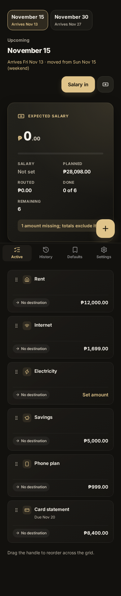
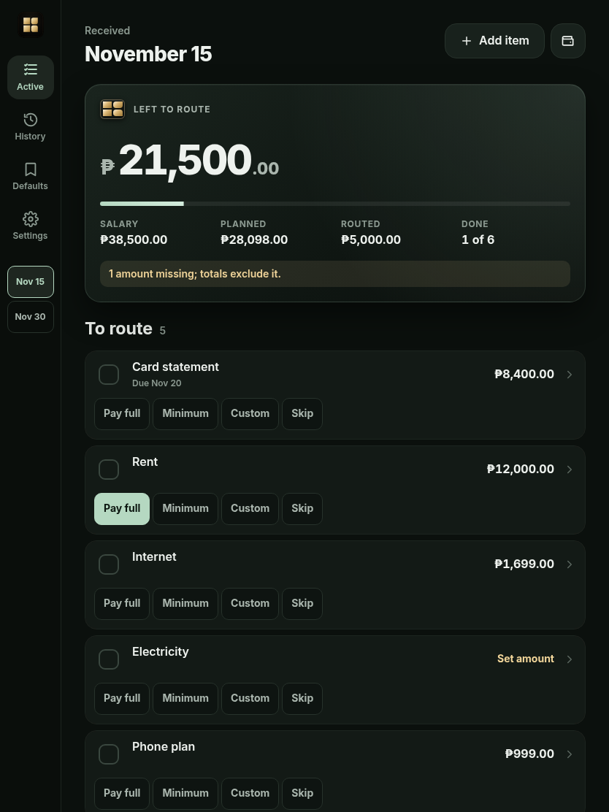
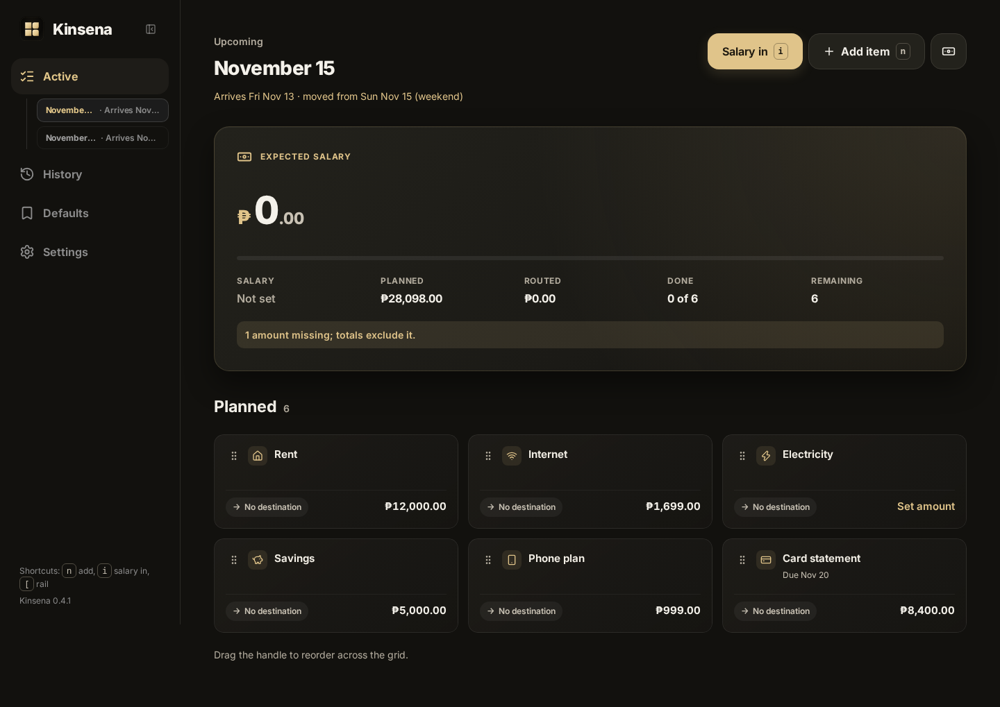
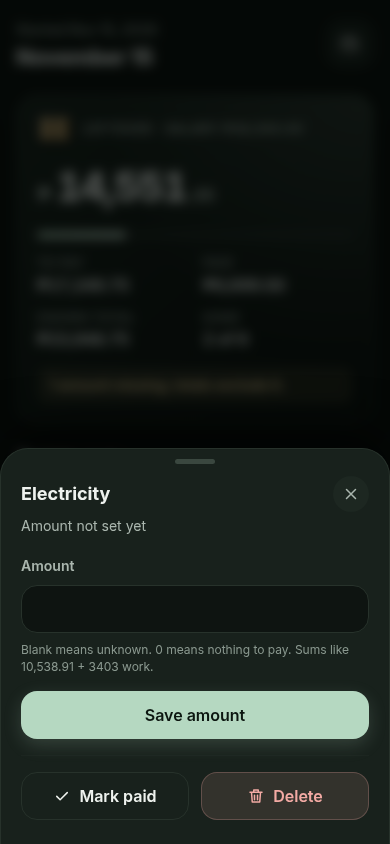
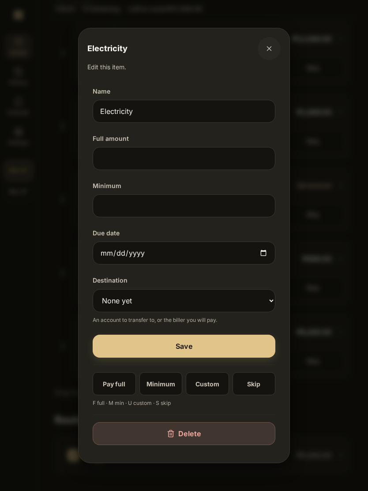
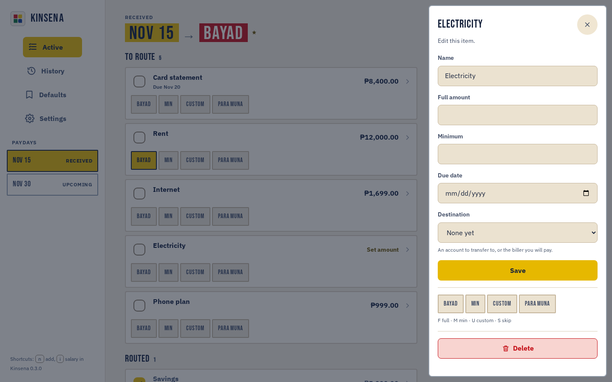
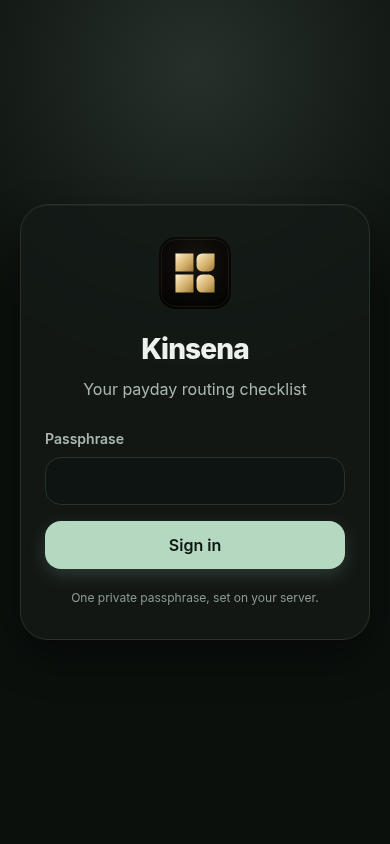

# Kinsena

A self-hosted payday routing checklist for bills, statements, and transfers. It is not a bank integration or an expense tracker. Before payday you record incoming bills and the date you will pay them. When salary arrives you go item by item and decide where that money goes — a biller, an account, or left unrouted.

Color, type, and motion live in one token file so a later look can be a token swap.

## Screenshots

Example data only (no personal records).

| Mobile                                                     | Tablet                                                     | Desktop                                                      |
| ---------------------------------------------------------- | ---------------------------------------------------------- | ------------------------------------------------------------ |
|  |  |  |
|  |        |    |



Kinsena adapts to three layouts:

- **Mobile** (under 640 px): bottom navigation, floating add button, and a draggable bottom sheet editor.
- **Tablet** (640–1100 px): a slim icon rail, a roomier single column, and a centered dialog editor.
- **Desktop** (1100 px and wider): a full sidebar, the checklist and summary side by side, a side-panel editor, and keyboard shortcuts.

## Before you upgrade: back up your database

**Back up `data/kinsena.db` before the first run of a new version.** Kinsena upgrades databases from earlier releases in place (including the old REAL/DOUBLE peso columns, which become integer centavos once). Copy the file somewhere safe first, or use `deploy/backup.sh`:

```bash
cp data/kinsena.db "data/kinsena-$(date +%Y%m%d).db.bak"
```

## Run locally

Requires Node.js 22.17 or newer (see `.nvmrc`). Kinsena needs one passphrase of **at least 16 characters** in a private text file, outside this repository and outside synced notes. Create it with your password manager or a private editor, make it readable only by you, and never commit it. Kinsena refuses to start without it.

```bash
npm ci
npm run build
KINSENA_PASSWORD_FILE="$HOME/kinsena-deploy/credentials/password" npm start
```

Open http://127.0.0.1:8080. The server listens on loopback by default. Settings:

| Variable                | Default           | Purpose                                     |
| ----------------------- | ----------------- | ------------------------------------------- |
| `KINSENA_PASSWORD_FILE` | (required)        | Path to the passphrase file                 |
| `DB_PATH`               | `data/kinsena.db` | SQLite database file (directory is created) |
| `HOST`                  | `127.0.0.1`       | Address to listen on                        |
| `PORT`                  | `8080`            | Port to listen on                           |
| `MIGRATIONS_DIR`        | `drizzle`         | Database migrations shipped with the app    |

Never set `HOST=0.0.0.0` on a machine reachable from a shared network. To reach Kinsena from your phone, bind to a private interface such as your Tailscale address, or put an authenticated HTTPS gateway (for example Tailscale Serve) in front of loopback.

For Docker:

```bash
docker build -t kinsena .
docker run -d -p 127.0.0.1:8080:8080 \
  -v "$(pwd)/data:/app/data" \
  -v "$HOME/kinsena-deploy/credentials/password:/run/secrets/kinsena_password:ro" \
  -e KINSENA_PASSWORD_FILE=/run/secrets/kinsena_password \
  kinsena
```

The image runs as the unprivileged `node` user (UID 1000) and checks `/login` for health. Records live in `data/kinsena.db`; keep the volume shown above. If an earlier image created `data/` as root, run `sudo chown -R 1000:1000 data` once before starting the new one.

## Use

1. Add destinations (accounts and billers) and recurring items under **Defaults**. Leave the amount blank when it varies. Pick when each is funded: every payday, mid-month, month-end, or before the due date.
2. Kinsena creates the next 15th and month-end paydays automatically. In plan mode, add statements and bills to an upcoming payday. You can also add a payday on any other date.
3. When salary arrives, **Salary in** switches to routing mode. For each item choose Full, Min, Custom, or Skip (optionally move it to the next payday). Tick a routed item to mark it done; an **Undo** toast appears. Tap the row to edit it. On a phone you can also swipe a row left to delete it, with undo. Sums like `10,538.91 + 3403` work.
4. **Salary**, **Planned** (minimum through full), **Routed**, and **Left to route** skip blank amounts, and a warning counts them. An explicit `0` is different from blank.
5. Finish the payday to keep a read-only record in **History**. Finished one by mistake? Reopen the most recent finished payday.

Amounts are stored as integer centavos, and values with more than two decimals round half-up. **Settings** changes the currency symbol only; it does not convert amounts. Default mid-month and month-end salaries live in Settings too.

Keyboard shortcuts (outside text fields): `1`–`4` switch tabs, `n` adds an item, `i` marks salary in, `c` opens salary, note and finish, `Esc` closes the editor. In an item sheet, `F`, `M`, `U`, and `S` choose Full, Min, Custom, and Skip.

## Install on a phone

Kinsena ships its four-block K icon, a maskable variant, Apple touch icon, and a web manifest. Use **Add to Home Screen** in Safari, or the install action in other browsers; remote installs need HTTPS. **Online only:** there is no offline cache, so it never shows a stale payment state.

## Private access

There is one built-in login, with no registration or extra accounts. The passphrase never goes in the database or Git and is compared in constant time. Session cookies hold random tokens and are HTTP-only, SameSite Strict, and Secure except on loopback and Tailscale (100.64.0.0/10) addresses. Sessions last seven days; logging out revokes the session, and restarting Kinsena signs out every device. Changing the passphrase requires a restart. Ten failed sign-ins within a minute block further attempts until that minute passes. Cross-site form posts are rejected.

## Automatic home-server updates (Linux + Docker Compose)

A push to `main` runs [the publish workflow](.github/workflows/publish.yml): lint, type check, unit tests with coverage, end-to-end tests in three viewports, and a production build. Only then does it publish `ghcr.io/raquezha/kinsena:main` and `:sha-<commit>`. The home server checks for a new image every five minutes and on startup, with no inbound SSH or self-hosted runner.

`package.json` is the version source of truth. To release, bump `version`, commit, and push the matching tag (for example `v0.2.0`). That publishes `:0.2.0`, `:0.2`, `:stable`, and the commit's SHA tag. The workflow fails when the tag and `package.json` disagree. The Compose file follows `:main`; switch to `:stable` for release-only updates. Avoid `:latest`.

Setup on the server:

1. Make sure the GHCR package is **public**, Docker with the Compose plugin is installed, and `sqlite3` is available for backups. Docker access is host-level; keep that account secure.
2. `mkdir -p ~/kinsena-deploy/credentials ~/.config/systemd/user`, then put the passphrase file at `~/kinsena-deploy/credentials/password` **before** enabling updates.
3. Copy `deploy/compose.yaml` and `deploy/backup.sh` to `~/kinsena-deploy/`, and the four `deploy/kinsena-*.service` / `.timer` files to `~/.config/systemd/user/`.
4. If you already have records, **stop the old container, back up, and move the database to `~/kinsena-deploy/data/kinsena.db` before the first start.** Never overwrite an existing database.
5. Enable the timers:

```bash
systemctl --user daemon-reload
systemctl --user enable --now kinsena-update.timer kinsena-backup.timer
systemctl --user start kinsena-update.service kinsena-backup.service
systemctl --user status kinsena-update.service kinsena-backup.service
```

The updater waits for the container health check and reports failure, but does not roll back on its own. The unit expects Docker at `/usr/bin/docker`. For checks after a reboot without logging in, enable lingering for that user. Compose binds port 8080 to **loopback only**.

The daily backup uses SQLite's online backup and an integrity check, writing private timestamped files to `~/kinsena-deploy/backups/`. **Those are on the same server and are not disaster recovery.** Copy them to another device and test restoring a copy. Run one manually with `sh ~/kinsena-deploy/backup.sh`.

To roll back, change the Compose image to a previous `:sha-<commit>` tag and run `systemctl --user start kinsena-update.service`. Restore a backup if a release changed stored data.

## Development

```bash
npm run dev           # Vite dev server on 127.0.0.1:5173 (needs KINSENA_PASSWORD_FILE)
npm run lint          # Prettier + ESLint
npm run check         # svelte-check (TypeScript strict)
npm test              # Vitest unit and integration tests
npm run test:coverage # with v8 coverage thresholds
npm run test:e2e      # build + Playwright in mobile, tablet and desktop viewports
npm run screenshots   # regenerate docs/screenshots with example data
npm run icons         # re-render PNG/ICO icons from static/*.svg
npm run db:generate   # create a Drizzle migration after editing the schema
```

Built with Svelte 5 (runes), SvelteKit, TypeScript, Drizzle ORM on better-sqlite3, and Zod. There is no UI library or third-party CDN.

```
src/
  lib/domain/         pure rules: calendar, money, decisions, destinations, summaries
  lib/server/data/    Drizzle schema, migrations runner, legacy upgrade, repositories
  lib/server/services payday, route, template, destination, settings use cases
  lib/server/auth/    passphrase file, constant-time check, sessions, rate limit
  lib/server/http/    origin checks, session cookie, form parsing
  lib/server/testing/ in-memory repositories and clock for fast tests
  lib/client/         optimistic checklist, sheets in the URL, toasts, shortcuts
  lib/ui/             tokens, layout, overlay sheet, checklist, brand, icons
  routes/             SvelteKit pages and form actions
drizzle/              SQL migrations
e2e/                  Playwright tests and screenshot capture
deploy/               Compose file, systemd units, backup script
server.js             production entry (loopback by default)
```

## License

MIT. See [LICENSE](LICENSE).
