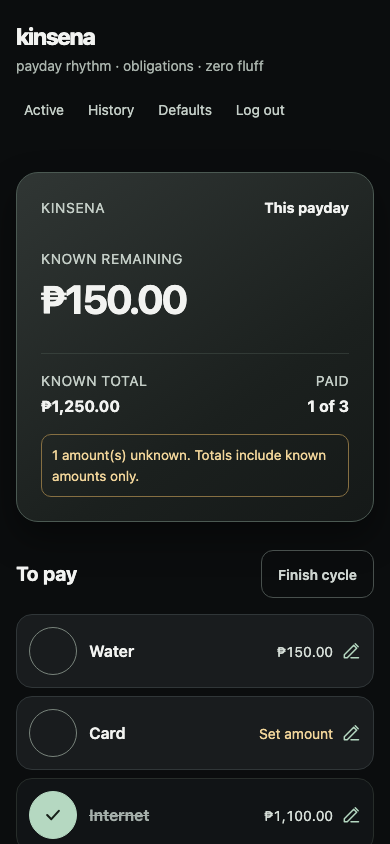

# Kinsena

A small, self-hosted checklist for things you handle each payday. This is not a bank integration or an expense tracker. Add saved items once, start a cycle, enter amounts when known, and mark items done.

## Screenshots

Mobile login and checklist with example items (no personal records):




## Run

Requires JDK 21. Kinsena requires one passphrase (at least 16 characters) in a private text file, outside this repo and outside synced notes. Create the file using your password manager or a private editor, keep it readable only by the server user, and never commit it. From the repo root:

```bash
KINSENA_PASSWORD_FILE="$HOME/kinsena-deploy/credentials/password" ./gradlew run
```

Open http://127.0.0.1:8080. The server listens on loopback by default; it is not reachable from other devices without a protected gateway.

For Docker:

```bash
docker build -t kinsena .
docker run -d -p 127.0.0.1:8080:8080 -v "$(pwd)/data:/app/data" -v "$HOME/kinsena-deploy/credentials/password:/run/secrets/kinsena_password:ro" -e KINSENA_PASSWORD_FILE=/run/secrets/kinsena_password kinsena
```

All records are stored in `data/kinsena.db`. Docker needs the volume shown above to preserve them. Existing database files remain compatible; no migration or personal payees are added automatically to a new installation.

## Automatic home-server updates (Linux + Docker Compose)

A push to `main` runs [the publish workflow](.github/workflows/publish.yml). GitHub builds and tests the Docker image, then publishes `ghcr.io/raquezha/kinsena:main` and a commit-specific `sha-<commit>` tag. The home server checks for a new image every five minutes and on startup. No inbound SSH or self-hosted GitHub runner is needed. When the server was off during a push, it catches up on its next check.

Before setup, confirm the GHCR package is **public** in GitHub's package settings so the server can pull it without registry credentials. Install Docker with the Compose plugin on the server. The user running the update timer must be able to run Docker. Install the `sqlite3` command on the server for scheduled backups. Docker access has host-level privileges; keep that user and its account secure.

On the server, run `mkdir -p ~/kinsena-deploy/credentials ~/.config/systemd/user`. Put a private passphrase file at `~/kinsena-deploy/credentials/password` **before** enabling automatic updates. Do not add that file to Git. From your local clone, copy `deploy/compose.yaml` to `~/kinsena-deploy/compose.yaml` on the server. Copy the four `deploy/kinsena-*.service` and `deploy/kinsena-*.timer` files to `~/.config/systemd/user/`, and copy `deploy/backup.sh` to `~/kinsena-deploy/backup.sh` on the server. If you already have Kinsena records on that server, **stop the old container and move its database into `~/kinsena-deploy/data/kinsena.db` before the first start**. Do not overwrite an existing database. Then run on the server:

```bash
systemctl --user daemon-reload
systemctl --user enable --now kinsena-update.timer kinsena-backup.timer
systemctl --user start kinsena-update.service
systemctl --user start kinsena-backup.service
systemctl --user status kinsena-update.service kinsena-backup.service
```

The updater waits for the container's login page health check and reports failure if the new container does not start. It does not automatically restore the previous image; use the rollback instructions below if an update fails. The unit assumes Docker is at `/usr/bin/docker`. Adjust that path if your installation differs. A user timer starts when that user's systemd session starts. For checks after a reboot **without anyone logging in**, ask your server administrator to enable lingering for that user. Docker's `restart: unless-stopped` restarts the existing container at boot while the update timer waits.

The Compose file binds port 8080 to **loopback only** and keeps the database under `~/kinsena-deploy/data/`. Use a private HTTPS gateway such as Tailscale Serve to reach it from your phone; do not publish the port directly. The daily backup timer uses SQLite's online backup command and checks database integrity. It writes private timestamped files to `~/kinsena-deploy/backups/`. **These files are on the same server, not a disaster recovery plan.** Copy backups to another device and test restoring one before relying on automatic updates. Monitor free disk space and remove old backups only after a tested off-device copy.

To roll back a bad release, temporarily change the Compose image from `:main` to a previously published `:sha-<commit>` tag and run `systemctl --user start kinsena-update.service`. Restore a database backup if a release changed stored data. The timer does not roll back automatically.

## Use

1. Add recurring item names under **Defaults**. Leave the amount blank for items that vary.
2. Start a cycle from **Active**. One cycle can be open at a time.
3. Tap the circle to mark an item paid. Tap its amount to edit or remove the item, then tap **Save**. `10,538.91 + 3403` also works.
4. **Known total** and **remaining** exclude blank amounts; a warning counts them. Zero entered explicitly is different from blank.
5. Finish the cycle to keep a read-only record in **History**. If you finish it by mistake, reopen the most recent cycle before starting a new one. Update saved default amounts under **Defaults** without changing past cycles.

Values with more than two decimal places round half-up to cents. The app records what you confirm; it does not check your bank.

## Install on a phone

Kinsena has an original vector icon, a web manifest, and home-screen icons for installation. Use Safari's **Add to Home Screen** on iPhone, or the browser install action on other platforms. Remote installs need HTTPS. **Online only:** there is no offline cache; the app will not show an old payment state when disconnected.

## Private access and backups

There is one built-in login, not public registration or multiple accounts. The passphrase never goes in the database or Git. Session cookies contain random tokens, are HTTP-only, SameSite Strict, and Secure for non-local hosts. They expire after seven days. Logout revokes that session; restarting Kinsena signs out all devices. Changing the passphrase requires a restart. Ten failed attempts within a minute temporarily block further login attempts until that minute passes.

Do not expose port 8080 to the internet or a shared LAN. To reach it from a phone, use an authenticated HTTPS gateway that proxies to loopback (or a private tunnel whose access you control). Set `HOST=0.0.0.0` inside a container only when the published host port is restricted as shown above. Protect the gateway against cross-site requests.

For an extra private, integrity-checked backup, run this on the home server:

```bash
sh ~/kinsena-deploy/backup.sh
```

Keep backups on another device and periodically test a restore using a *copy* of the backup, not your live database. Stop the server before replacing the live database.

## Development

`./gradlew test` checks login, session revocation, amount edge cases, editable defaults, reopen behavior, the HTTP payment flow, history protection, and install assets. The backend is Kotlin/Ktor, the database is SQLite/Exposed, and pages use server-rendered HTML and plain forms; there is no JavaScript build or third-party CDN.

## License

MIT. See [LICENSE](LICENSE).
